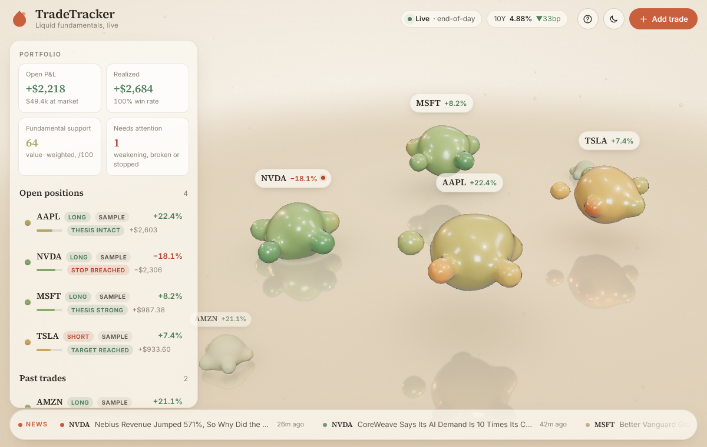
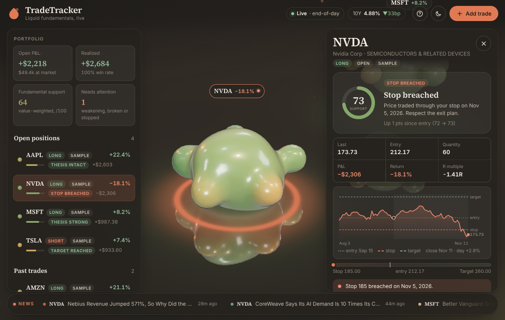

# TradeTracker

A live, 3D trade tracker. It watches company news and fundamentals for every position you log and runs five fundamental analyses to tell you whether each trade's thesis still holds.

Each trade is a pool of liquid in a warm, Claude-inspired palette. Five droplets orbit the core, one for each fundamental pillar, and keep fusing back into it. When a headline arrives it falls in as a droplet and ripples the pool.




## What it does

- **Tracks your trades.** Open and closed, long and short, with optional stop, target and thesis. Add them in the UI or import a CSV.
- **Monitors news.** Pulls each company's latest headlines along with Massive's per-ticker AI sentiment and its reasoning. New articles stream into the view live.
- **Runs five fundamental checks per company** (each scored 0–100):

  | # | Pillar | What it looks at | Source |
  |---|--------|------------------|--------|
  | 1 | **Valuation** | P/E, P/S, FCF yield, PEG, earnings yield vs. the 10-year Treasury | Price × shares, SEC filings, Treasury yields |
  | 2 | **Growth** | TTM revenue and earnings growth, quarterly revenue acceleration | SEC 10-Q/10-K (XBRL) |
  | 3 | **Profitability** | Net, operating and gross margin, ROE, margin trend | SEC 10-Q/10-K |
  | 4 | **Financial health** | Liabilities/equity, current ratio, net-debt payback, cash conversion | SEC 10-Q/10-K |
  | 5 | **News & sentiment** | Recency-weighted news tone over 30 days, short-interest days-to-cover | Massive news + short interest |

- **Checks the state of every trade.** It combines the pillars into a *fundamental support* score oriented to your direction (weak fundamentals support a short). Together with P&L, stop and target, that gives a verdict: *Thesis strong*, *intact*, *weakening*, *broken*, *Stop breached* or *Target reached*.
- **Compares now vs. entry.** Fundamentals are rebuilt *point-in-time* from only the filings that existed on your entry (and exit) date. You can see whether the thesis has improved or deteriorated since you got in.
- **Raises alerts** for stop and target hits, adverse headlines in the last 48 hours, a pillar flipping against you since entry, losses with no stop, and fresh filings.
- **Post-mortems past trades.** Shows the realized P&L, fundamentals at exit, and how the price has moved since you sold.

## Reading the pool

| You see | It means |
|---|---|
| Size of a cell | Position value |
| Height | P&L: winners float, losers sink into the pool |
| Core colour | Fundamental support for *your* position (clay red = against you, amber = mixed, sage = supporting) |
| Five orbiting droplets | The five pillars, sized and coloured by score, fusing in and out of the core |
| Faster, wobblier motion | More news flow and higher volatility |
| Falling droplet + ripple | A new headline, coloured by sentiment |
| Matte stones on the outer ring | Past (closed) trades |

Drag to orbit, scroll to zoom, and click a cell or row for details. Keyboard: `↑`/`↓` (or `j`/`k`) cycle trades, `n` adds a trade, `Esc` closes the panel.

## Quick start

```bash
npm install
```

```bash
cp .env.example .env    # then set MASSIVE_API_KEY
```

```bash
npm run dev
```

Open http://127.0.0.1:3000.

With no `MASSIVE_API_KEY` the app runs in **demo mode** on synthetic, clearly-labelled data, so you can try it without an account. The first run loads a few sample trades; delete them from each trade's panel.

For a production build:

```bash
npm run build && npm start
```

## Hosted website (claude.ai)

The same app also runs as a hosted page on claude.ai, with no server of your own:

- `npm run build:hosted` builds `web/dist-hosted/`. It contains `page.html` (a page fragment) and `assets/`, using `vite.hosted.config.js`, which swaps the data layer for `web/src/hosted/api.js`.
- The page runs the engine and the five-pillar analysis in the browser.
- **Trades** live in the page's database (`trades/<id>`). You add and edit them on the site.
- **Market data** can't be fetched from the browser, because the host blocks outside network calls. `scripts/sync-hosted.js` fetches it from Massive and SEC EDGAR and writes one JSON file per database document: `market/<T>`, `news/<T>`, `filings/<T>`, `macro/rates` and `meta/sync`. Claude then writes those files into the page database. The page streams changes in live, so new headlines drop into the pool.
- Signed-out viewers and previews fall back to the synthetic demo.
- **Ask Claude for a read** in a trade's panel sends that trade's pillars, verdict and headlines to Claude for a short plain-language assessment.

To refresh the data (what Claude does on each sync):

1. Export the site's trades with the ArtifactData tool: `list` on `trades` with `out_dir`. Also list `requests`, the tickers someone asked to refresh.
2. Run the sync:

   ```bash
   NODE_USE_ENV_PROXY=1 node scripts/sync-hosted.js --trades <exported trades dir> --out <dir> --cache data --force <requested tickers>
   ```

3. Write the files with ArtifactData `batch` using `file_path` entries. Pass each existing document's `version` as `if_version` (list the collections to get it), and leave it out for new tickers.
4. Delete the handled `requests/<T>` documents.

## Configuration

All settings live in `.env` (see `.env.example`):

| Variable | Default | Notes |
|---|---|---|
| `MASSIVE_API_KEY` | — | Key from [massive.com](https://massive.com) (formerly Polygon.io). |
| `DATA_MODE` | `auto` | `live`, `demo`, or `auto` (live when a key is set). |
| `MASSIVE_RPM` | `5` | Requests per minute your plan allows. The free tier is 5; raise it on paid plans. |
| `SEC_USER_AGENT` | `TradeTracker/0.1 (...)` | SEC asks automated clients to identify themselves. Add your app name and a contact email. |
| `NEWS_REFRESH_MIN` | `10` | Minutes between news refreshes per ticker. |
| `PRICE_REFRESH_MIN` | `15` | Minutes between price refreshes per ticker. |
| `PORT` / `HOST` | `3000` / `127.0.0.1` | The server binds to localhost by default. It has no auth, so keep it that way. |

Behind a corporate proxy, start Node with `NODE_USE_ENV_PROXY=1` so `fetch` honours `HTTPS_PROXY`.

## Data sources and limits

- **Massive** supplies daily prices, news with sentiment insights, ticker details (name, CIK, shares), short interest and Treasury yields. All requests go through one priority queue that respects your per-minute limit. Prices and news for open trades load first. On the free tier, a fresh portfolio of five or six tickers takes about five minutes to load fully. Everything is cached in `data/cache.json`, so restarts are instant.
- **Real-time vs. end-of-day.** The free tier serves end-of-day prices. If your plan includes snapshots, the app detects that and switches to intraday quotes automatically.
- **SEC EDGAR** supplies the financial statements, free and without a key. Quarters are rebuilt from 10-Q/10-K XBRL facts: Q4 is derived from the annual figure, and cash flows are differenced from year-to-date values. Companies that don't file US-GAAP statements (ETFs, most foreign issuers) show the four statement pillars as unavailable. Their verdict then rests on the remaining pillars.
- Ratios use market cap rather than per-share figures, so stock splits don't distort them.

This is a research tool, not investment advice.

## Importing trades

Use **Import CSV** in the portfolio panel. The header names are matched loosely:

```
ticker,direction,quantity,entry_date,entry_price,stop,target,exit_date,exit_price,notes
AAPL,long,10,2026-03-02,241.10,220,290,,,Services growth
AMZN,long,50,2026-03-10,214.33,,,2026-08-18,259.45,AWS re-acceleration
```

## HTTP API

| Method | Path | |
|---|---|---|
| `GET` | `/api/state` | Full evaluated portfolio |
| `GET` | `/api/stream` | Server-Sent Events: `state` and `news` |
| `GET` / `POST` | `/api/trades` | List or create trades |
| `PUT` / `DELETE` | `/api/trades/:id` | Update or delete a trade |
| `POST` | `/api/trades/import` | Bulk create (JSON array) |
| `POST` | `/api/refresh/:ticker` | Re-queue a ticker's news and prices |

## Project layout

```
server/
  index.js            Express app, REST + SSE, Vite middleware in dev
  engine.js           Feed scheduler, recompute loop, portfolio state
  analysis/
    xbrl.js           Point-in-time quarters/TTM from SEC facts
    pillars.js        The five fundamental analyses
    trade.js          P&L, stops/targets, verdicts, alerts
  providers/          Massive, SEC EDGAR and demo data sources
  lib/                Rate limiter, cache, SSE hub
web/
  src/scene/          Three.js: metaball trade cells, reflective ripple pool
  src/ui/             Panels, charts, trade dialog
test/                 node:test suites (run with `npm test`)
data/sample-trades.json
```
